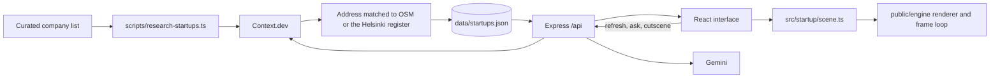

# Architecture

Startup City is a single page app on top of a WebGL renderer, with a small Express server that holds the API keys.

## Renderer

`public/engine/` holds the city renderer. `game.js` owns the camera, frame loop, rider and street-level movement. The other modules add the Helsinki map (`helsinki-real-map.js`, `helsinki-geography.js`), lighting and the painted day sky (`helsinki.js`), the northern lights and oil-paint surfaces (`oil-paint/`), and pedestrians. `webworld.js` hands the engine, the map and a per-frame hook to the interface.

The city is one scene and one frame loop. Buildings are batched into one mesh per 150 m tile, and geometry is uploaded to the GPU a few tiles per frame while the title screen shows, so opening the city view never freezes.

## Scene layer

`src/startup/scene.ts` turns the engine into a map:

- **City view.** An orbit camera (target, distance, heading, tilt) on the engine's free camera. Zoom keeps the point under the cursor fixed, dragging grabs the ground and glides on release, two fingers turn and tilt.
- **Street level.** Hands control back to the rider beside the chosen building; the camera blends between the two.
- **Opening flight.** Keyframes from high over the harbour, with the northern lights above the city, down to the city view.
- **Cutscenes.** A cinematic mode that ignores input and plays scripted camera moves (establish, aurora, flyover, orbit, close, rise).
- **Markers, glow and links.** Each startup building gets an additive glow mesh and a light beam; Junction partners get an aurora gradient, a halo and a taller beam. Markers are HTML positioned by projection, skipped when the camera has not moved. Connection arcs are drawn on a 2D canvas.
- **Routes.** A* over the mapped streets and paths. Shown on the street-level minimap.
- **Picking.** The pointer ray is marched through a grid of building footprints.
- **Graphics levels.** Auto, Smooth, Balanced and Detailed set render resolution, draw distance from above and tree density. Auto lowers resolution when frames are slow and drops a level if that is not enough.

## Day and night

`src/startup/sun.ts` computes the sun's position over Helsinki for any date and time. The engine blends sun colour, sky light, fog, window glow and a painted day sky over the night look by sun elevation. The northern lights only show when the sky is dark enough. By default the city follows the real Helsinki clock; the clock in the sidebar picks a part of the day, any time, a time-lapse or midsummer.

## Interface

React with a small Zustand store (`src/startup/store.ts`). The sidebar holds filters, categories, the live feed, the In town board, missions, the directory and the clock; the company profile opens on the right. The design uses one typeface (Google Sans Flex), three text sizes, sentence-case labels and one accent colour taken from the aurora. Gemini's output is marked with a blue to violet gradient.

Sound lives in `src/startup/audio.ts`. The score is generated in the browser with the Web Audio API (soft pads, a felt piano that improvises over a slow D major progression, wind and a long reverb), so nothing is downloaded. Settings has a master switch (also mutes narration and effects, key M), a music switch and a volume slider. Music ducks while a narrator speaks. Cutscenes can be paused (Space), advanced a line (right arrow) or skipped (Esc).

## Server

`server/index.ts` serves the API and, in production, the built site. `server/startups/` contains:

| File | Role |
| --- | --- |
| `context.ts` | Context.dev: company profiles, news, careers pages, research, monitors, address matching |
| `gemini.ts` | Gemini: question to filters, answers from a record, connection suggestions |
| `cutscenes.ts` | Cutscene scripts (Gemini), narration (Gemini TTS, voice set by `GEMINI_VOICE`), cache by content hash |
| `routes.ts` | API routes, refresh batching and caching, per-visitor rate limits |

| Route | Purpose |
| --- | --- |
| `GET /api/startups` | Company records, suggestions, which services are configured |
| `POST /api/signals/refresh` | Read news and careers pages again through Context.dev |
| `POST /api/ask` | A question about one company, answered from its record |
| `POST /api/search` | A question turned into map filters (the search bar is switched off in the interface for now) |
| `POST /api/connections/suggest` | Regenerate Gemini's relationship suggestions |
| `POST /api/cutscene` | Script and narration for a cutscene |
| `GET`, `POST /api/monitors` | Context.dev page monitors |
| `GET /api/in-town` | Published Slush and Junction lineups, plus current visitor posts |
| `POST /api/in-town` | Add an opt-in post; returns a private removal token |
| `DELETE /api/in-town/:id` | Remove a post with its token |

In town posts hold only what the visitor types, are checked for email addresses and phone numbers, and are deleted after their last day. The removal token is stored as a hash. Posts are kept in `data/in-town-posts.json`, which is never committed.

Keys stay on the server. Calls that spend credits are rate limited per visitor. If the API is unreachable the browser loads `public/data/startups-snapshot.json` and says so.

## Tests

- `npm test`: data contract, address placement, filters, missions, connections, sun position, cutscene schema.
- `npm run test:browser`: both camera modes, profiles and provenance labels, filters and routes, cutscenes, the day cycle, the guided tour, the offline fallback and the phone layout. Gemini and Context.dev are replaced with fixtures.
- `node scripts/test-helsinki-map.mjs`: map geometry, collision, landmarks and pedestrian paths.

## Credits for the renderer

The movement, camera and rendering core is adapted, with permission, from an earlier browser game client. Everything specific to that game has been removed or switched off.
